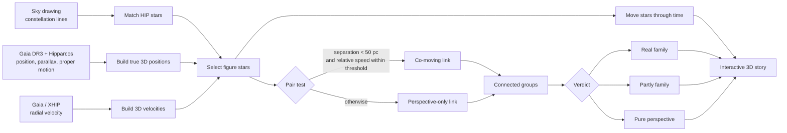
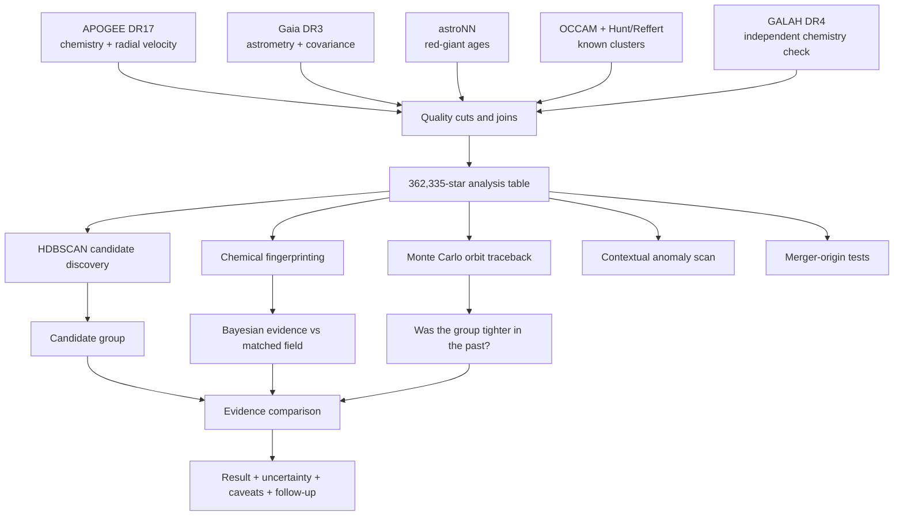

# Solaria

Solaria turns familiar constellations from flat sky drawings into testable 3D structures. It combines measured distance and motion data to answer a simple question: **are these stars a real family, or do they only look close from Earth?**

The repository also contains a broader Galactic-archaeology engine, internally named **Palimpsest**, for finding stellar families, tracing their orbits, comparing their chemical fingerprints, investigating unusual stars, and testing whether stars resemble ancient Milky Way merger debris.

## Why this matters

Humans see a constellation as a 2D pattern, but its stars can be hundreds or thousands of light-years apart. That creates a powerful gap between appearance and reality that Solaria makes visible. The same measurements also support real research questions: which stars formed together, where they came from, and which parts of the Milky Way were assembled through mergers?

The current local analysis covers:

- **88 constellations** and **710 bright stars** in the interactive Unfolder.
- **362,335 APOGEE DR17 × Gaia DR3 stars** in the research pipeline.
- **332,366 stars** with all of the first eight chemical-fingerprint elements measured.
- **1,522 high-probability OCCAM cluster members** used as known examples and validation targets.
- **227,191 red giants** with access to the age-analysis path.

These are dataset and capability counts, not claimed user adoption or measured social impact. The immediate impact is educational: a judge, student, or visitor can move from a cultural sky drawing to evidence about true distance and motion. The research impact is a reproducible workflow that keeps discovery, validation, uncertainty, and limitations visible.

## Judge demo: 60 seconds

1. Open **The Big Dipper**. It looks like one flat object from Earth.
2. Click **Unfold into 3D**. The stars separate by their measured distances.
3. Point out the highlighted stars moving together: some of the picture is a real stellar family, while other stars are chance alignment.
4. Move the time slider. Proper motion and radial velocity show the figure changing over one million years into the past or future.
5. Choose **Orion** or **Cassiopeia** to show a different result, or draw a new constellation and let the same test classify it.

The one-sentence pitch:

> Solaria reveals the physical truth behind the pictures we draw in the sky, then uses the same evidence-first approach to reconstruct stellar families and the history of our Galaxy.

See [docs/JUDGE_GUIDE.md](docs/JUDGE_GUIDE.md) for the full speaking script, model explanations, limitations, and judge questions.

## How the app works



For two stars, the Constellation Unfolder computes their 3D separation and relative velocity. They are connected as co-moving when:

```text
separation < 50 parsecs
and
relative speed < max(3 km/s, 2 × combined velocity uncertainty)
```

Connected co-moving pairs become groups. If at least half of the selected stars belong to such groups, the app labels the pattern **Real family**; if some do, **Partly family**; if none do, **Pure perspective**. This is an interpretable screening rule, not proof that stars were born together.

## Scientific pipeline



## Models and methods

| Model or method | What it does | Why it is used | Where |
|---|---|---|---|
| HDBSCAN | Finds dense groups in 6D position/velocity or orbital-action space without choosing the number of clusters first | Candidate discovery | `backend/palimpsest/families.py` |
| Gaussian mixture model | Learns the abundance distribution of comparable field stars | Provides the field-star alternative in chemical hypothesis tests | `backend/palimpsest/chemistry.py` |
| Bayesian evidence ratio | Compares “one shared birth chemistry” with “independent field stars” | Gives an interpretable group-level test | `backend/palimpsest/chemistry.py` |
| Chi-square chemical match | Compares two stars element by element using errors plus a systematic floor | Fast pair-level chemical screening | `backend/palimpsest/chemistry.py` |
| McMillan (2017) potential | Integrates trajectories in a detailed Milky Way gravitational model | Main orbit reconstruction | `backend/palimpsest/orbits.py` |
| MWPotential2014 | Repeats orbit calculations under a second Galactic model | Exposes model dependence | `backend/palimpsest/orbits.py` |
| Monte Carlo sampling | Draws astrometry and radial velocity from their measured covariance and errors | Propagates uncertainty into trajectories and encounter tests | `backend/palimpsest/orbits.py` |
| Robust contextual z-scores | Compares a star with chemically or dynamically similar stars | Finds explainable anomalies instead of one opaque score | `backend/palimpsest/anomalies.py` |
| Literature action/chemistry cuts | Tests Gaia–Sausage/Enceladus-like dynamics independently from accreted-like chemistry | Checks a known merger signature without circular selection | `backend/palimpsest/merger.py` |

No generative-AI model is used to decide whether stars are related. The core verdicts come from measured astronomical data, explicit thresholds, statistical models, and gravitational dynamics. The Hunt & Reffert source catalogue includes ages estimated with a neural network, and astroNN provides data-driven red-giant age estimates; those are labeled as model-dependent inputs.

## Run the judge-facing app

Requirements: Node.js 20 or newer.

```bash
cd frontend
npm ci
npm run dev:constellations
```

Open [http://localhost:5174/constellations.html](http://localhost:5174/constellations.html).

Build the standalone experience with:

```bash
cd frontend
npm run build:constellations
```

The build is written to `frontend/dist-constellations/`.

## Run the scientific API/workbench

Requirements: Python 3.11+ and Node.js 20+. The full workbench also needs the survey catalogues and generated Parquet tables named in `backend/palimpsest/config.py`; these are intentionally not committed because several individual files are 100 MB to 1.7 GB.

```bash
python -m venv .venv
source .venv/bin/activate
pip install -r requirements.txt
PYTHONPATH=backend uvicorn palimpsest.api:app --reload
```

In a second terminal:

```bash
cd frontend
npm ci
npm run dev
```

The API runs at `http://127.0.0.1:8000`; Vite proxies `/api` calls to it.

## Data flow and provenance

The ingestion order is:

```text
APOGEE base + astroNN + OCCAM
  -> Gaia DR3 astrometry and covariance
  -> derived positions, velocities, actions and orbit shape
  -> optional GALAH cross-survey check
  -> known-cluster and constellation products
  -> validation and API analysis
```

Every scientific constant that changes a result is centralized in `backend/palimpsest/config.py`. Reports generated by the API include selection choices, potential choice, time range, uncertainty sampling, references, and caveats.

## Repository map

```text
backend/palimpsest/
  ingest/             survey ingestion and joins
  api.py              FastAPI routes
  analysis.py         workflow orchestration
  chemistry.py        chemical fingerprints and evidence
  families.py         HDBSCAN discovery and group evaluation
  orbits.py            Galactic potentials and Monte Carlo integration
  traceback.py         historical convergence and encounters
  anomalies.py         explainable contextual outliers
  merger.py            ancient-merger consistency tests
  constellations.py    3D constellation analysis

frontend/src/
  constellations/      standalone judge-facing Unfolder
  views/               research-workbench screens
  three/               3D Milky Way rendering

data/cache/constellations.json
  compact curated data used by the standalone demo
```

## Honest limitations

- Co-motion is necessary but not sufficient for common birth; chemistry and age are stronger follow-up tests.
- Reversing individual stellar orbits is reliable only over limited times because the real Milky Way evolves and measurements have uncertainty.
- Bright-star metallicities and ages in the constellation demo are heterogeneous literature compilations.
- Statistical evidence depends on the reference population and model assumptions, so results include empirical null tests and caveats.
- The repository excludes the multi-gigabyte raw catalogues and generated caches. They are reproducible data dependencies, not source code.

