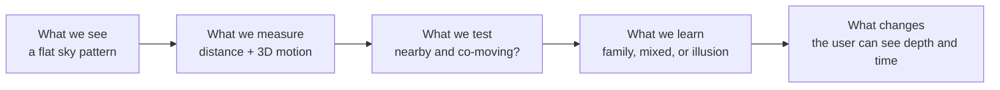
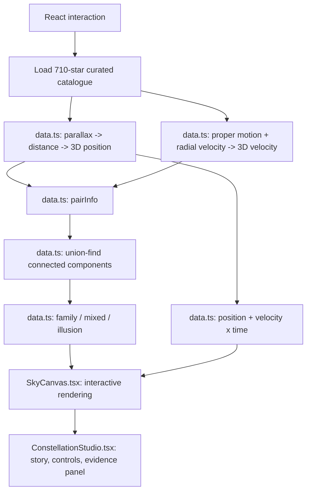

# Solaria judge guide

## The story in one line

Solaria starts with a picture everyone knows, unfolds it into real 3D space, and uses measured motion to reveal whether the stars are a family or a coincidence.

## The problem

A constellation is a cultural drawing projected onto the night sky. Our eyes throw away depth: two stars can appear side by side even when one is hundreds or thousands of light-years behind the other. A static sky map cannot show that difference, and it cannot tell us whether the stars travel together.

This matters at two levels:

1. **Public understanding:** space is three-dimensional and dynamic, but most astronomy tools still begin and end with a flat map.
2. **Galactic archaeology:** the same distance, motion, chemistry, and age evidence lets researchers search for stellar siblings and reconstruct how the Milky Way formed.

## The solution

Solaria combines a familiar visual hook with an evidence pipeline:

## A three-minute demo script

### 0:00–0:25 — Hook

“Everyone recognizes the Big Dipper, but the picture only exists from Earth. We wanted to answer a deceptively simple question: are these stars actually together?”

Open the Big Dipper in Earth view.

### 0:25–1:00 — Reveal depth

Click **Unfold into 3D**.

“We match every star in the drawing to measured parallax. Parallax gives distance, so the flat drawing unfolds into its true depth. What looked like one object is spread across space.”

Point to the nearest/farthest distances and the depth multiple.

### 1:00–1:35 — Reveal motion and logic

“Distance alone does not make a family. We also combine proper motion with radial velocity to build a 3D velocity. For every pair, we check whether the stars are within 50 parsecs and whether their relative speed is smaller than a threshold that includes measurement uncertainty.”

Point to the highlighted co-moving subgroup.

“The Big Dipper is partly a real moving family and partly a perspective effect.”

### 1:35–2:05 — Show time

Move the time control.

“Stars are not pinned to a dome. We propagate their measured velocities to show how the familiar figure changes over a million years in either direction.”

### 2:05–2:30 — Make it personal

Choose **Draw a constellation** and connect a few stars.

“The same test works on any pattern the user creates. The output is not an AI guess; it is derived from the measurements and an explicit, visible rule.”

### 2:30–3:00 — Broader impact

“The public experience is the front door. Behind it, our Palimpsest engine scales the same evidence-first idea to 362,335 stars: it finds candidate stellar families, compares their chemistry, traces their orbits with uncertainty, investigates anomalies, and tests ancient merger signatures. Solaria turns wonder into a scientific question, and a scientific question into something people can see.”

## The code path

### Important frontend files

- `frontend/src/constellations/ConstellationStudio.tsx`: application state, stories, controls, and explanation panel.
- `frontend/src/constellations/SkyCanvas.tsx`: canvas renderer, camera, unfolding animation, picking, and motion display.
- `frontend/src/constellations/data.ts`: catalogue conversion, physical calculations, pair test, connected groups, and verdict.
- `frontend/src/constellations/Viz.tsx`: supporting distance, kinship, and impact visuals.
- `frontend/src/constellations/studio.css`: responsive visual design.

### Important backend files

- `backend/palimpsest/ingest/`: builds the scientific table from APOGEE, Gaia, astroNN, OCCAM, GALAH, and cluster catalogues.
- `backend/palimpsest/orbits.py`: Milky Way potentials, astrometric Monte Carlo sampling, and trajectory integration.
- `backend/palimpsest/chemistry.py`: pair statistics, intrinsic scatter, field GMM, and Bayesian evidence.
- `backend/palimpsest/families.py`: HDBSCAN discovery and multi-evidence evaluation.
- `backend/palimpsest/traceback.py`: group convergence and star-cluster encounter tests.
- `backend/palimpsest/anomalies.py`: contextual, explainable anomaly detection with quality checks.
- `backend/palimpsest/merger.py`: independent dynamical and chemical tests for accreted populations.
- `backend/palimpsest/api.py`: FastAPI boundary consumed by the research UI.

## Models, in plain language

### HDBSCAN

This clustering algorithm finds dense islands in position-and-velocity space. We do not tell it how many families to find. It proposes candidates; it does not prove they are families.

### Chemical fingerprint model

Stars born in the same cloud should have very similar element abundances. A Gaussian mixture model describes the chemistry of comparable field stars. A Bayesian evidence ratio then asks whether a candidate group is better explained by one shared chemical fingerprint or by unrelated field stars.

### Galactic gravity models

The McMillan (2017) Milky Way potential is the main model used to integrate stellar trajectories. We can repeat calculations with MWPotential2014. If the answer changes strongly, the interface can expose that model dependence rather than hide it.

### Monte Carlo uncertainty

Gaia reports errors and correlations for parallax and proper motion, and radial velocity also has error. We repeatedly sample plausible measurements, integrate each one, and show a distribution of possible histories instead of one falsely exact line.

### Anomaly model

An unusual orbit is only meaningful relative to comparable stars. The code compares a star’s orbit with stars of similar chemistry and compares its chemistry with stars on similar orbits. Robust z-scores show which measurement makes it unusual, while quality checks flag binaries, weak parallaxes, or possible cross-match problems.

### What is and is not AI

The core app does **not** use a large language model or image classifier to decide the verdict. Its main models are clustering, mixture modelling, Bayesian statistics, error propagation, and gravitational dynamics. Two age inputs are data-driven: astroNN estimates red-giant ages, and the Hunt & Reffert catalogue provides neural-network-derived cluster ages. Those ages are labeled as inferred and are never presented as direct measurements.

## Actual scale and impact

What has been built and measured:

- The Unfolder contains 88 constellation figures and 710 bright stars.
- The full local scientific table contains 362,335 stars and 138 columns.
- 332,366 stars have complete measurements for the first eight chemical dimensions.
- 1,522 stars are high-probability OCCAM cluster members, providing known populations for calibration or validation.
- Unit tests cover coordinate frames, Galactic dynamics, uncertainty covariance, synthetic traceback recovery, chemical evidence, and clustering behavior.

What should not be overstated:

- There is no measured user-adoption or learning-outcome study yet.
- A co-moving classification is a screening result, not proof of common birth.
- Long-term traceback is model-dependent and eventually chaotic.
- A future impact study should measure whether users better understand stellar depth, motion, and uncertainty after the demo.

## Likely judge questions

### “How do you know two stars are related?”

For the public demo, we require both spatial proximity and consistent 3D motion within measurement uncertainty. In the research workflow, that candidate is then tested independently with chemistry, ages, known-cluster matches, and orbital traceback.

### “Why not just use distance?”

Two stars can pass near the same place but move in different directions. A family must be coherent in position and velocity; chemistry and age make the case stronger.

### “Is the verdict generated by AI?”

No. The constellation verdict uses a transparent numerical rule. The broader research system uses interpretable statistical and dynamical models, with uncertainty and reference populations shown.

### “What makes this different from a planetarium?”

A planetarium reproduces apparent sky position. Solaria makes true depth, 3D motion, physical relationships, uncertainty, and change over time the center of the experience.

### “What is the next step?”

Add a guided classroom mode, measure pre/post understanding, publish the compact constellation experience, and connect candidate-family results to follow-up spectroscopy proposals.

## Final line

“Constellations are stories humans drew on the sky. Solaria adds the physical story the stars themselves are telling.”

